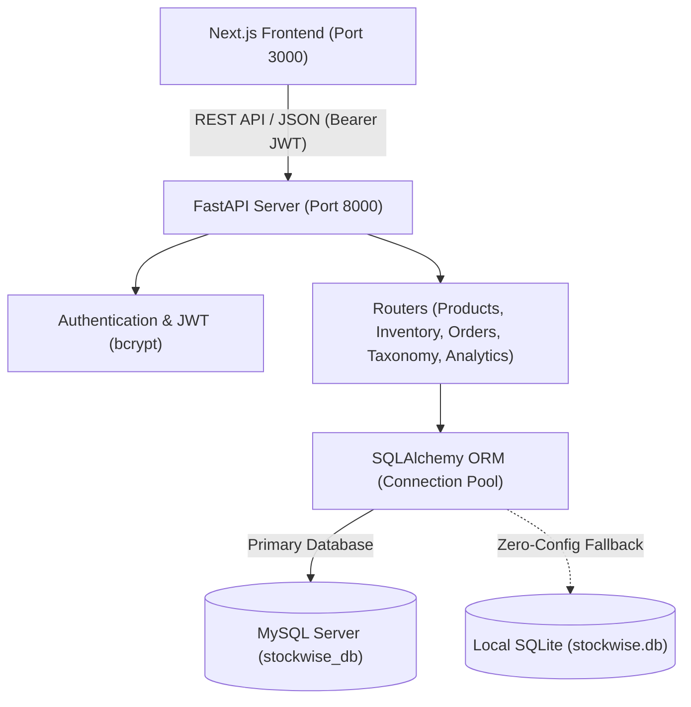

# StockWise — Inventory Intelligence Full-Stack Platform

## 1. Repository Analysis: Does the original repo contain a backend?
**No, the original repository (`https://github.com/padmadarshan/stock-management-`) does NOT contain a backend.**
- It is a Next.js frontend prototype generated with v0.
- All state was persisted purely inside browser `localStorage` (`stockwise-products`, `stockwise-movements`, etc.).
- There were no API routes (`app/api` did not exist) and no database connection.
- The UI itself explicitly displayed banners saying: *"Changes are saved locally in this browser only. Connect a backend for shared persistence and permissions."*

---

## 2. What We Have Built In This Workspace

This repository now contains a complete, production-grade **Full-Stack Solution**:
1. **Primary Backend**: High-performance **FastAPI (Python)** REST API with **MySQL support** via SQLAlchemy & PyMySQL (with automatic local SQLite fallback if MySQL is offline).
2. **Alternative Backend**: **Node.js + Express** backend in `node_backend/` for pure JavaScript environments.
3. **Database Layer**: MySQL schema script (`init_mysql.sql`) + automatic ORM table creation & database seeder (`seed.py`).
4. **Connected Frontend**: Next.js client in `frontend/` updated to communicate directly with the REST API via `frontend/lib/api.ts`.

---

## 3. Architecture & Tech Stack



| Component | Technology | Description |
|---|---|---|
| **Backend Framework** | FastAPI (Python 3.13) | Asynchronous REST API with Pydantic validation & OpenAPI |
| **Database** | MySQL (with SQLite fallback) | SQLAlchemy ORM with connection pooling & automated schema setup |
| **Authentication** | JWT + bcrypt | Secure bearer tokens and password hashing |
| **Documentation** | Swagger UI & ReDoc | Interactive API documentation at `/docs` and `/redoc` |
| **Frontend** | Next.js 16 + React 19 + TypeScript | Full inventory dashboard with live backend sync |

---

## 4. API Endpoints Reference

### 🔐 Authentication (`/api/auth`)
| Method | Endpoint | Description |
|---|---|---|
| `POST` | `/api/auth/register` | Register new user account |
| `POST` | `/api/auth/login` | Login and receive JWT access token |
| `GET` | `/api/auth/me` | Retrieve profile of authenticated user |

### 📦 Products Catalog (`/api/products`)
| Method | Endpoint | Description |
|---|---|---|
| `GET` | `/api/products` | List products with optional search, category, and low-stock filters |
| `GET` | `/api/products/{id}` | Get product details by ID |
| `GET` | `/api/products/barcode/{code}` | Fast lookup for barcode scanner |
| `POST` | `/api/products` | Create product (auto-generates sequential `PRD-XXX` ID and checks SKU uniqueness) |
| `PUT` | `/api/products/{id}` | Update product information |
| `DELETE` | `/api/products/{id}` | Remove product from catalog |
| `POST` | `/api/products/{id}/adjust-stock` | Increment/decrement stock with automatic audit movement log |

### 🔄 Inventory Movements & Transfers (`/api/inventory`)
| Method | Endpoint | Description |
|---|---|---|
| `GET` | `/api/inventory/movements` | List all historical stock movements |
| `POST` | `/api/inventory/stock-in` | Record incoming stock intake |
| `POST` | `/api/inventory/stock-out` | Record outgoing dispatch with quantity validation |
| `GET` | `/api/inventory/transfers` | List location transfers |
| `POST` | `/api/inventory/transfers` | Move items between locations (e.g. 'Store Room' to 'Lab A') |

### 🤝 Suppliers & Procurement (`/api/suppliers`, `/api/orders`)
| Method | Endpoint | Description |
|---|---|---|
| `GET` | `/api/suppliers` | List all registered suppliers |
| `POST` | `/api/suppliers` | Add new supplier contact and lead time |
| `DELETE` | `/api/suppliers/{id}` | Delete supplier (guarded against active product dependencies) |
| `GET` | `/api/orders` | List purchase orders and line items |
| `POST` | `/api/orders` | Create draft purchase order |
| `POST` | `/api/orders/{id}/mark-ordered` | Advance purchase order status to 'Ordered' |
| `POST` | `/api/orders/{id}/receive` | Receive order: automatically increments product stock and logs audit movement |

### 🏷️ Taxonomy (`/api/taxonomy`)
| Method | Endpoint | Description |
|---|---|---|
| `GET` | `/api/taxonomy/categories` | List all categories |
| `POST` | `/api/taxonomy/categories` | Create unique category |
| `DELETE` | `/api/taxonomy/categories/{name}` | Delete category (blocked if products are currently assigned) |
| `GET` | `/api/taxonomy/brands` | List all brands |
| `POST` | `/api/taxonomy/brands` | Create unique brand |
| `DELETE` | `/api/taxonomy/brands/{name}` | Delete brand (blocked if products are currently assigned) |

### 📊 Analytics & Reporting (`/api/analytics`, `/api/settings`)
| Method | Endpoint | Description |
|---|---|---|
| `GET` | `/api/analytics/dashboard` | Returns total products, stock units, inventory valuation, low stock & out-of-stock counts |
| `GET` | `/api/analytics/alerts` | List products below the threshold setting |
| `GET` | `/api/analytics/expiry` | Expiry tracking with remaining days classification |
| `GET` | `/api/analytics/export/{type}` | Download dynamic CSV export (`products`, `movements`, `reports`) |
| `GET` | `/api/settings` | Read alert threshold, expiry days, and dark mode preferences |
| `PUT` | `/api/settings` | Update configuration settings |

---

## 5. How to Run the Project

### A. Quick Start (Windows Batch Launchers)
1. Double-click `start_backend.bat` to launch the FastAPI server on port 8000.
2. Double-click `start_frontend.bat` to launch the Next.js frontend on port 3000.

### B. Manual Terminal Execution

#### 1. Start FastAPI Backend:
```bash
# In the root backend directory:
.\venv\Scripts\activate
python main.py
```
> The API will be available at: **http://127.0.0.1:8000**  
> Interactive Swagger documentation: **http://127.0.0.1:8000/docs**

#### 2. Start Next.js Frontend:
```bash
cd frontend
npm install # or pnpm install
npm run dev
```
> The UI will be available at: **http://localhost:3000**

---

## 6. Configuring MySQL

By default, the backend checks for MySQL at `localhost:3306` with database `stockwise_db`.
- **If MySQL is running**: The backend automatically connects, creates all tables, and seeds initial data.
- **If MySQL is not running**: The backend automatically falls back to `./stockwise.db` (SQLite) with zero crash risk, so you can test immediately.

To point to your custom MySQL instance, edit `.env`:
```env
DATABASE_URL=mysql+pymysql://<user>:<password>@<host>:<port>/stockwise_db
```
You can also run `init_mysql.sql` directly inside MySQL Workbench or CLI:
```bash
mysql -u root -p < init_mysql.sql
```

---

## 7. Default Credentials
- **Email**: `jordan@acmecampus.edu`
- **Password**: `password123`
- **Role**: `Administrator`
